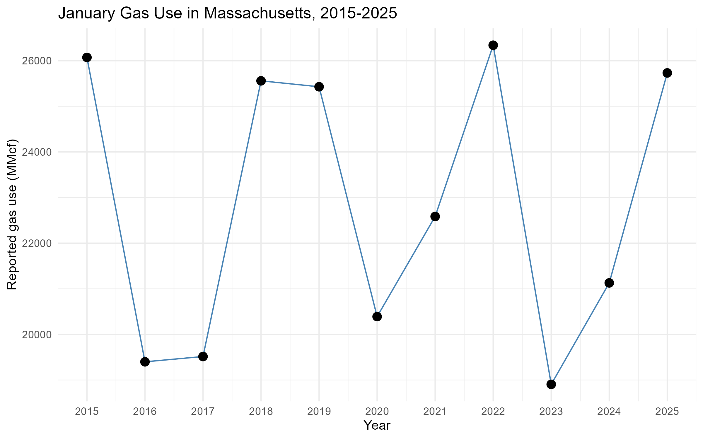
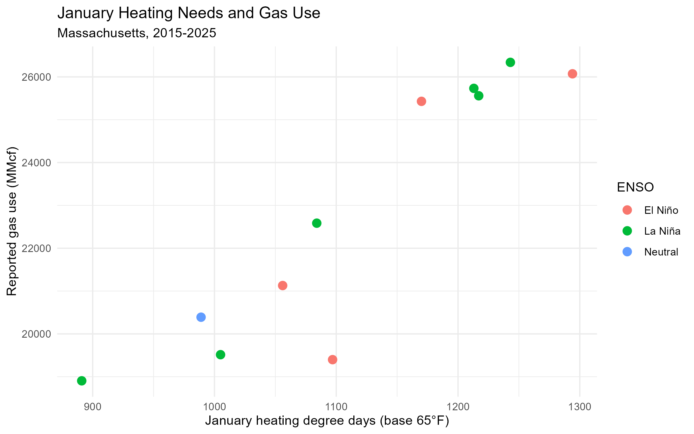
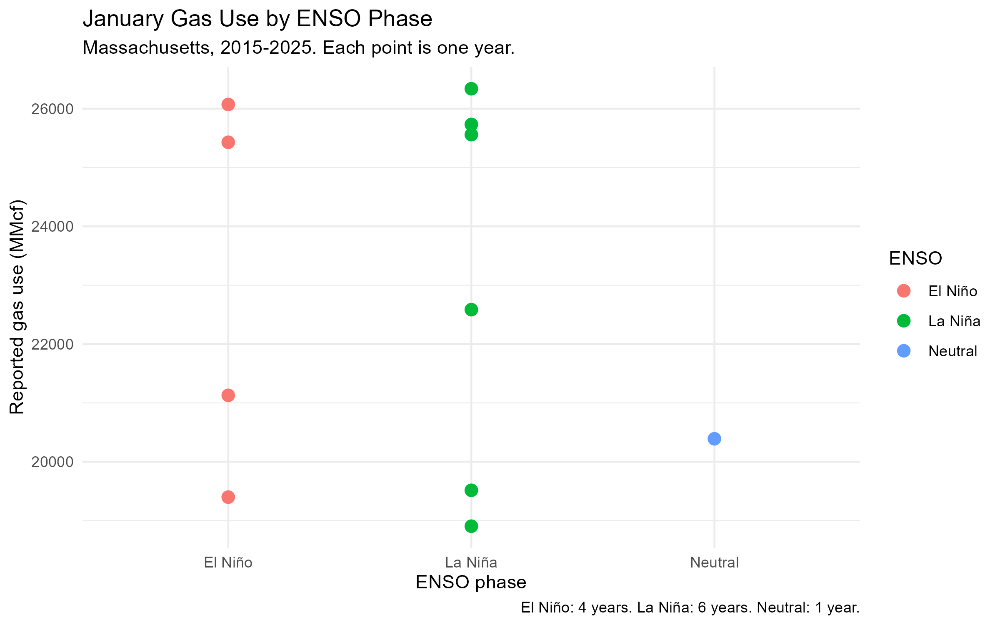
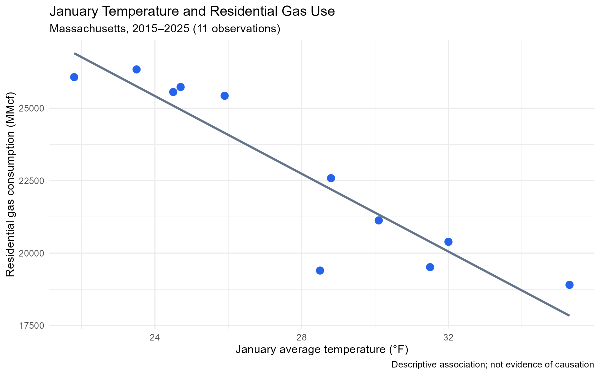
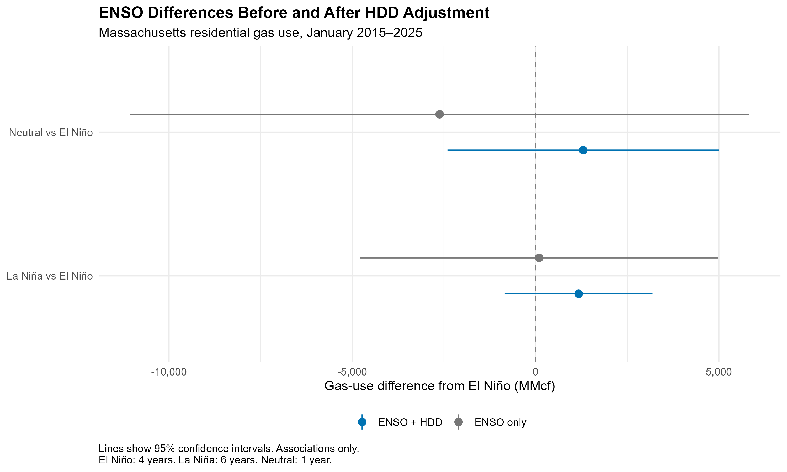
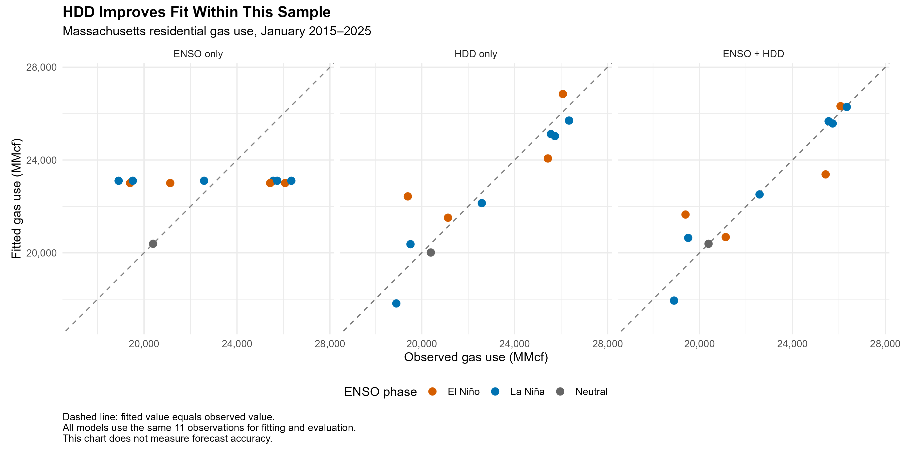

# Natural Gas Consumption and Winter Weather

**Course:** ADEC7900 Software Tools  
**Team:** Team 2  
**Project:** Checkpoint 2  
**Branch:** `Team_2Checkpoint_2.0`

## Introduction

Our project explores how natural gas consumption relates to winter weather, including El Niño, La Niña, and heating degree days (HDD).

Our research question is: **How does residential natural gas consumption differ between El Niño and La Niña winters, and how is it related to heating degree days?**

Our decision makers are energy companies planning January residential gas demand in Massachusetts. We examine January observations from 2015 through 2025, giving us 11 observations.

For Checkpoint 2, we added NOAA weather analysis, ENSO group statistics, regression models, and two model-comparison charts. Our additional analysis question is: **Does ENSO add explanatory value beyond heating degree days alone?**


## Progress on the Eight Major Tasks

| Major task | Progress through Checkpoint 2 |
| --- | --- |
| 1. Research topic | Defined the research question and energy-company decision maker. Added an excursion examining whether ENSO adds explanatory value beyond HDD. |
| 2. GitHub collaboration | Shared work on Team_2Checkpoint_2.0. All three members have contributed their own commits. |
| 3. Combining data sources | Merged EIA residential gas consumption with NOAA weather data by year. The dataset contains 11 January observations from Massachusetts. |
| 4. Data visualization | Retained three initial charts, added a temperature chart, and added two charts comparing regression estimates and fitted values. |
| 5. Summary statistics and models | Calculated weather summaries and ENSO group KPIs. Compared ENSO-only, HDD-only, and combined models using R², adjusted R², in-sample RMSE, and a partial F test. |
| 6. Project checkpoints | Completed the Checkpoint 1 draft and developed the Checkpoint 2 analysis on the required branch. |
| 7. Video presentation | Prepared a five-minute presentation outline. Recording remains for the final project. |
| 8. Final Markdown report | Defined the five required report sections. We are integrating the current findings, limitations, and preliminary recommendation into the report draft. |

The video outline and final report structure document preparation for the later project deliverables.

## Data Summary

| Source | Information used | Included file |
| --- | --- | --- |
| U.S. Energy Information Administration (EIA) | Massachusetts residential natural gas consumption, measured in million cubic feet (MMcf). | [Natural Gas EIA Data.xlsx](data/Natural%20Gas%20EIA%20Data.xlsx) |
| NOAA weather workbook | January average temperature, January HDD with a 65°F base, DJF RONI, and ENSO phase labels. | [NOAA_Massachusetts_January_2015_2025.xlsx](data/NOAA_Massachusetts_January_2015_2025.xlsx) |

The gas consumption values match the January 2015–2025 values in the [EIA Massachusetts residential consumption series](https://www.eia.gov/dnav/ng/hist/n3010ma2m.htm).

The merged dataset contains one row for each January from 2015 through 2025. ENSO labels come from the supplied NOAA workbook and are preserved during the merge.

### Combining and Checking the Data

The [merge script](code/MergedData.R):

1. Reads the EIA and NOAA Excel files.
2. Selects January EIA observations from 2015 through 2025.
3. Creates a year field and joins the EIA observations to the NOAA workbook by year.
4. Sorts the combined data by year.
5. Checks for 11 rows, duplicate years, and missing gas consumption values.
6. Exports [Massachusetts_January_Combined.csv](data/Massachusetts_January_Combined.csv).

The merged CSV has **11 observations, no duplicate years, and no missing values in any column**. These checks assess the merged file's completeness.

## Summary Statistics

| Measure | Result |
| --- | ---: |
| January observations | 11 |
| Average January residential gas consumption (MMcf) | 22,823.09 |
| Lowest January residential gas consumption (MMcf), 2023 | 18,905 |
| Highest January residential gas consumption (MMcf), 2022 | 26,339 |
| Average January HDD, base 65°F | 1,114.45 |
| Correlation between January HDD and gas consumption | 0.915 |

| ENSO phase | Number of years | Average gas consumption (MMcf) | Average January HDD |
| --- | ---: | ---: | ---: |
| El Niño | 4 | 23,007.25 | 1,154.25 |
| La Niña | 6 | 23,105.83 | 1,108.83 |
| Neutral | 1 | 20,390.00 | 989.00 |

All statistics above use the 11 observations in the merged CSV.

## Data Analytics

The [visualization script](code/Initial_Visualizations.R) creates the following three images.

### 1. January Gas Use by Year



January residential gas consumption varies across years. The highest value is 26,339 MMcf in 2022, and the lowest is 18,905 MMcf in 2023.

### 2. January Heating Needs and Gas Use



Higher HDD values generally go with higher gas consumption. The correlation is approximately 0.915. This shows a strong positive association within this sample. It does not establish causation.

### 3. January Gas Use by ENSO Phase



Average gas consumption is similar for El Niño and La Niña years, and the individual observations overlap. This sample does not show a clear separation between these two groups. Only one Neutral year is available.


### 4. NOAA Weather Analysis — Checkpoint 2

For Checkpoint 2, we added a new analysis of January weather and residential natural gas consumption in Massachusetts from 2015 to 2025. The dataset includes 11 January observations.

**Weather Data Summary**

The average January temperature was 27.9°F, ranging from 21.8°F to 35.3°F. The average January heating degree days (HDD) was approximately 1,114.5.

**Temperature and Natural Gas Consumption**

We found a strong negative correlation between January average temperature and residential natural gas consumption (r = -0.917). This suggests that colder January temperatures were generally associated with higher gas consumption.

HDD and gas consumption showed a strong positive correlation (r = 0.915). Higher HDD values were generally associated with higher gas consumption.

**New Visualization**



The scatter plot shows that gas consumption generally decreases as January temperature increases.

**Limitations**

The analysis only includes 11 January observations from Massachusetts. These relationships are descriptive and do not prove causation.

**Supporting Files**

- [NOAA Analysis R Script](code/NOAA_Checkpoint2_Analysis.R)
- [NOAA Weather Summary](outputs/noaa_weather_summary.csv)
- [NOAA ENSO Summary](outputs/noaa_weather_by_enso.csv)
- [NOAA Data Documentation](NOAA_Checkpoint2_Data_Documentation.md)

### 5. EIA Regression Analysis — Checkpoint 2

Garrett's analysis compares two regression models:

- **ENSO only:** Compares gas consumption across ENSO phases.
- **ENSO + HDD:** Compares ENSO phases while accounting for January heating degree days.

El Niño is the reference category. Both models use the same 11 observations.

| Model | Term | Estimate (MMcf) | 95% confidence interval | p-value |
| --- | --- | ---: | --- | ---: |
| ENSO only | La Niña relative to El Niño | 98.58 | −4,781.44 to 4,978.60 | 0.964 |
| ENSO only | Neutral relative to El Niño | −2,617.25 | −11,069.69 to 5,835.19 | 0.496 |
| ENSO + HDD | HDD, per additional degree-day | 23.70 | 15.26 to 32.14 | <0.001 |
| ENSO + HDD | La Niña relative to El Niño | 1,175.00 | −841.44 to 3,191.43 | 0.211 |
| ENSO + HDD | Neutral relative to El Niño | 1,299.31 | −2,402.27 to 5,000.90 | 0.434 |



The estimated La Niña–El Niño difference rises from approximately 99 MMcf to 1,175 MMcf after accounting for HDD. However, both confidence intervals include zero. This sample does not establish a clear difference between these phases.

In the combined model, an additional HDD is associated with approximately 23.70 MMcf more gas consumption, holding ENSO phase constant. These estimates describe associations and do not establish causation.

Neutral comparisons require particular caution because the dataset contains only one Neutral year.

### 6. Excursion: Does ENSO Add Information Beyond HDD?

Our additional question is: **Does including ENSO improve the explanation of January gas consumption beyond HDD alone?**

Anh added an HDD-only model and compared all three models.

| Model | Parameters, including intercept | R² | Adjusted R² | In-sample RMSE (MMcf) |
| --- | ---: | ---: | ---: | ---: |
| ENSO only | 3 | 0.0706 | −0.1617 | 2,795.86 |
| HDD only | 2 | 0.8363 | 0.8181 | 1,173.34 |
| ENSO + HDD | 4 | 0.8727 | 0.8182 | 1,034.65 |



HDD alone explains approximately 83.6% of the variation in gas consumption within this sample. Adding ENSO increases R² to approximately 87.3%, but adjusted R² barely changes. The extra model parameters account for much of the apparent improvement.

A partial F test compares the HDD-only model with the combined model. The result is **F(2, 7) = 1.001, p = 0.415**. This small sample does not provide clear evidence that ENSO adds explanatory value after accounting for HDD. This does not prove that ENSO has no relationship with demand.

The chart shows fitted values from the same observations used to estimate the models. It does not measure forecast accuracy. Models containing the Neutral indicator fit that group's single observation exactly, which does not demonstrate an ability to predict other Neutral years.

Supporting files:

- [Regression analysis](code/Statistical_Analysis.R)
- [Model comparison and visualization script](code/Checkpoint2_Visualizations.R)
- [Regression estimates and confidence intervals](data/ENSO_Model_Results.csv)
- [Model-fit summary](outputs/model_fit_summary.csv)
- [Partial F test](outputs/hdd_enso_comparison.csv)
- [Observed and fitted values](outputs/model_fitted_values.csv)

### Using R: Advantages and Challenges

R allowed us to merge datasets, calculate statistics, fit regression models, and export charts through scripts that teammates can rerun.

Challenges included coordinating file paths, keeping the ENSO reference category consistent, and exporting regression results correctly. Restarting R exposed an undefined object in the original export code. We fixed this by explicitly creating the results table. Using relative paths from the project root helps teammates run the same scripts.

## Scope and Limitations

- The analysis covers Massachusetts residential gas consumption in January.
- The 11 observations do not represent all winter months or all natural gas use.
- ENSO groups have different sizes, with only one Neutral observation.
- The analysis describes historical patterns and associations. It is not a demand forecast.
- The NOAA weather values and ENSO classifications are taken from the supplied workbook.

## Conclusion

We merged EIA residential natural gas consumption with NOAA weather data for Massachusetts January observations from 2015 through 2025.

Higher HDD and lower temperatures were strongly associated with greater gas consumption. Average consumption was similar across El Niño and La Niña years. After accounting for HDD, the estimated ENSO differences remained uncertain.

Our excursion found that HDD alone provided most of the models' explanatory power. Adding ENSO barely changed adjusted R², and the partial F test did not establish a clear improvement.

These findings cover only 11 January observations, including one Neutral year. They do not establish causation or forecast accuracy. Future work should verify the ENSO classifications, expand the sample, examine model diagnostics, and evaluate performance on observations not used for fitting.

## Policy Recommendation (Preliminary)

Our decision maker is a Massachusetts energy company deciding how to use weather information in January supply planning.

We recommend prioritizing local HDD when developing and validating a January demand model. ENSO should remain an additional factor to test with a larger dataset. The current results do not justify changing supply commitments based on ENSO phase alone.

The intended first-order effect is to make demand planning more responsive to local heating conditions. A possible second-order benefit is fewer supply mismatches, which could support service reliability for households.

The benefit is a planning approach supported by the strongest association in our sample. Risks include uncertain weather, omitted demand drivers, and the small dataset. Overestimating demand could create unnecessary supply costs, while underestimating it could leave insufficient supply. The company should validate a broader model before using it to determine purchase quantities.

## Team Contributions

| Team member | Contributions through Checkpoint 2 |
| --- | --- |
| Garrett Barnachez | Collected EIA data, prepared the merged dataset and merge script, calculated ENSO group KPIs, fitted the two main regression models, and added EIA documentation. |
| Yiting Pei | Supplied NOAA weather data, calculated weather summaries and ENSO comparisons, created the temperature–gas chart, and added NOAA documentation and findings to the README. |
| Anh Bui | Set up and organized GitHub, created the initial visualizations, fixed the regression-results export, added confidence intervals and two model-comparison charts, completed the HDD-only excursion, and integrated the checkpoint report. |

## GitHub Collaboration

### Progress

- All three members have contributed their own commits to `Team_2Checkpoint_2.0`.
- Garrett and Yiting uploaded their analysis and documentation before Anh integrated the findings.
- We coordinated responsibilities through our group conversation to reduce overlapping work.
- We used separate scripts for weather analysis, regression analysis, and visualization.
- We committed and pushed completed changes using GitHub Desktop.

### Challenges and Remaining Hurdles

Earlier write-access problems delayed collaboration. Teammates have since been able to upload their own work.

Shared README edits require coordination. We need to fetch and pull the latest changes before editing shared files and confirm that we are working on the correct branch.

Before submission, we will review the integrated report, check that the chart images display on GitHub, and confirm that the run instructions reproduce the analysis.

## Repository Organization

| Location | Contents |
| --- | --- |
| Main folder | README.md, the RStudio project, and EIA/NOAA documentation. |
| `code` | Scripts for merging, weather analysis, regression analysis, and visualization. |
| `data` | Original EIA and NOAA workbooks, the merged CSV, ENSO KPIs, and regression results. |
| `images` | Six chart PNG files. |
| `outputs` | Weather summaries, model-fit comparisons, the partial F test, and fitted values. |

## How to Run the Analysis

1. Clone or download the repository and select `Team_2Checkpoint_2.0`.
2. Open `Group Project ADEC7900.Rproj` from the repository's main folder in RStudio.
3. Install these packages once if needed:

```r
install.packages(c("readxl", "readr", "dplyr", "ggplot2"))
```

4. Run the scripts in this order from the repository root:

```r
source("code/MergedData.R")
source("code/Initial_Visualizations.R")
source("code/NOAA_Checkpoint2_Analysis.R")
source("code/Statistical_Analysis.R")
source("code/Checkpoint2_Visualizations.R")
```

The merge script recreates the combined CSV from the two workbooks. The remaining scripts recreate the charts, summary tables, regression results, and model comparisons.

5. After running the scripts, use this code to reproduce the overall gas-use statistics:

```r
gas_compare %>%
  summarise(
    Years = n(),
    Average_gas_MMcf = mean(Gas),
    Minimum_gas_MMcf = min(Gas),
    Maximum_gas_MMcf = max(Gas),
    Average_HDD = mean(HDD),
    HDD_gas_correlation = cor(HDD, Gas)
  )
```

All inputs needed to rerun the current analysis are included in the repository. Charts save to `images`. Statistical results save to `data` and `outputs`.

## Video Presentation Outline

The five-minute presentation is structured as follows:

- **Minute 1:** Business context, decision maker, and research question.
- **Minute 2:** Data sources, January coverage, and merging method.
- **Minutes 3–4:** Weather relationships, ENSO regression results, and the HDD-only excursion.
- **Minute 5:** Limitations and implications for further winter-demand analysis.

## Final Markdown Report Structure

The final report follows the required sections:

1. **Introduction:** Business context, decision maker, and research question.
2. **Data Summary:** Sources, coverage, variables, and descriptive statistics.
3. **Data Analytics:** Visualizations, comparisons, and supporting analysis.
4. **Conclusion:** Findings, limitations, and future work.
5. **Policy Recommendation:** A recommendation supported by the completed analysis, including benefits and risks.
